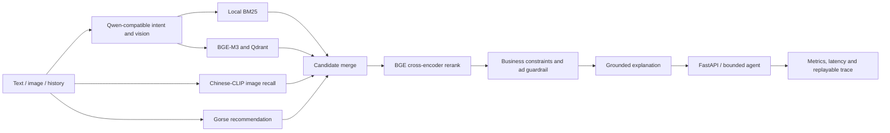

# Architecture

The `local` profile uses deterministic CPU implementations. The `server` profile replaces providers
without changing API contracts:

| Boundary | Local | Server |
|---|---|---|
| Intent and vision | Heuristic parser | Domestic OpenAI-compatible VLM API or local vLLM |
| Text retrieval | BM25 + hash vectors | BM25 + BGE-M3 in Qdrant |
| Image retrieval | Disabled | Chinese-CLIP |
| Recommendation | ItemCF | Gorse with ItemCF runtime fallback |
| Rerank | Transparent weighted ranker | BGE cross-encoder plus business ranker |

Every external boundary has a local fallback. The response trace records the selected provider, fallback
reason, candidate counts and stage latency.
