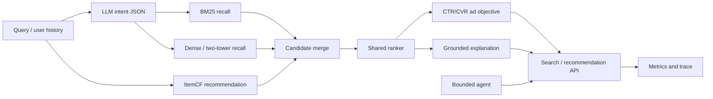

# Architecture

The local profile provides contract-compatible CPU implementations. It validates schemas, API behavior,
ranking composition, agent tool routing and evaluation before GPU rental. The server profile swaps only
model providers: hash vectors become BGE embeddings, the heuristic parser becomes Qwen, and the transparent
ranker can be replaced by LambdaRank/ESMM without changing request or response schemas.

Agent tools are deliberately bounded to `search_products`, `recommend_for_user` and `compare_products`.
Every call is written to the response trace, so task success, tool accuracy, invalid calls and latency can be evaluated.

